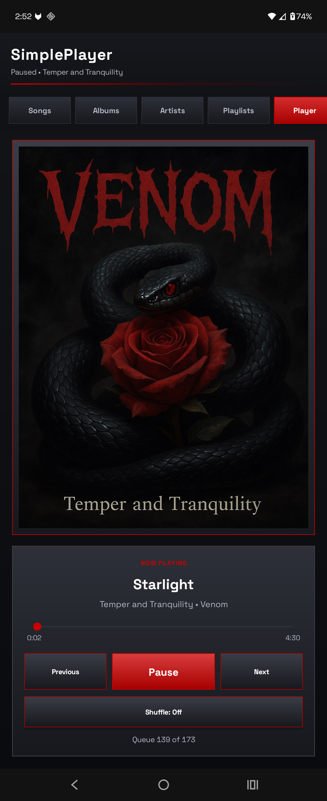
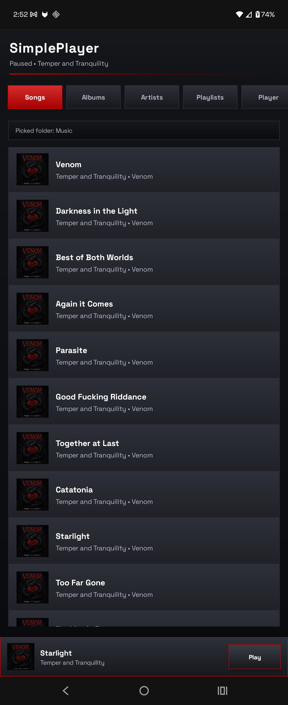
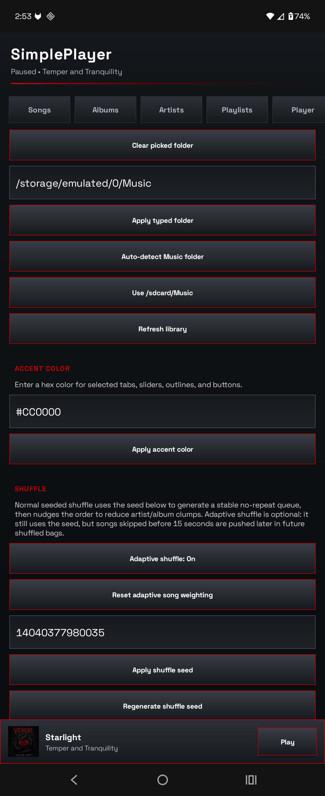

# SimplePlayer

A local Android music player for people who still believe music files are files and not tiny subscription hostages.

<p align="center">
  
  
  
</p>

SimplePlayer is a dark, local-only music player for Android 7.0 Nougat/API 24 and newer. It plays local audio, reads metadata, supports album art, uses editable text-file playlists, and does not require an account, cloud library, recommendation engine, or other nonsense.

Simple does not mean primitive. That was discussed.

## App Info

```text
Package: com.zoeykl.simpleplayer
Version: 0.8.2
Minimum Android: 7.0 Nougat / API 24
Language: Java
UI: Programmatic Android views
Playback: Android MediaPlayer + foreground service + MediaSession
```

## Features

```text
Local folder scanning
Android folder picker support
WAV-heavy library support
Songs / Albums / Artists / Playlists / Player / Settings / EQ tabs
Embedded metadata reading
RIFF/WAV INFO metadata fallback
Embedded album art
Folder-side album art
Missing-art visualization toggle
Plain text playlists
Seeded shuffle
Optional adaptive shuffle
15-band EQ control surface
Notification mini-player
Headset and Bluetooth controls
Android Auto media browsing / applet support
Portrait and landscape layouts
Custom accent color
Dark grey polished UI
```

No cloud sync. No account. No recommendations. No podcast tab bolted on with duct tape.

## Music Folder

SimplePlayer scans audio from a folder you choose.

It tries to auto-detect a folder named:

```text
Music
```

Common examples:

```text
/storage/emulated/0/Music
/sdcard/Music
/storage/XXXX-XXXX/Music
```

On newer Android versions, direct file paths can be hidden or inconsistent, so SimplePlayer also supports Android’s folder picker. Use Settings to choose the folder that actually contains your library.

## Supported Audio

```text
.mp3
.flac
.wav
.wave
.m4a
.aac
.ogg
.opus
```

WAV files are supported, but WAV metadata is often messy. SimplePlayer reads what it can and falls back to filenames and folders when the file provides nothing useful.

## Metadata

SimplePlayer reads metadata during library scans using:

```text
Android MediaMetadataRetriever
RIFF/WAV INFO chunks
Filename/folder fallback
```

Metadata feeds:

```text
Songs
Albums
Artists
Player screen
Notification player
Media session
Android Auto
Shuffle/queue display
```

Supported fields, when present:

```text
Title
Artist
Album
Track number
Genre
Year
Duration
Album art
```

## Album Art

Album art lookup order:

```text
Embedded album art
Same-folder artwork files
Android MediaStore album art
Placeholder or visualization
```

Supported same-folder artwork names include:

```text
AlbumArtSmall.jpg
AlbumArt_..._Small.jpg
AlbumArt.jpg
Folder.jpg
Cover.jpg
Front.jpg
```

Also checks common variants:

```text
.jpeg
.png
.webp
```

If no art exists, the optional missing-art visualization can animate in the Player screen instead.

## Playlists

Playlists are plain text files.

Playlist folder:

```text
/sdcard/Music/SimplePlayer/Playlists/
```

Every `.txt` file becomes a playlist. The filename becomes the playlist name.

Example:

```text
Road Music.txt
```

becomes:

```text
Road Music
```

Each non-empty line is one song reference.

Filename example:

```text
Deftones - Change.mp3
Nine Inch Nails - We're In This Together.flac
Carpenter Brut - Turbo Killer.mp3
```

Relative path example:

```text
Deftones/White Pony/Change.mp3
Nine Inch Nails/The Fragile/We're In This Together.flac
Carpenter Brut/Trilogy/Turbo Killer.mp3
```

Lines starting with `#` are ignored.

SimplePlayer can create playlists, add songs to playlists, and read playlists edited outside the app.

## Queue Behavior

From the Songs tab:

```text
Tap a song:
Play from the full visible Songs queue, starting at that song.

Long-press a song:
Play this song only
Add to playlist...
```

The Songs queue respects the current sort order.

## Sorting

Songs can be sorted by:

```text
Name
Date added
Artist
Album
```

Each sort supports:

```text
Ascending
Descending
```

## Shuffle

SimplePlayer has two shuffle modes:

```text
Seeded shuffle
Adaptive shuffle
```

Seeded shuffle is deterministic. Same seed plus same song list equals the same shuffled order. It builds a full shuffled queue and plays through it without repeats before rebuilding.

Adaptive shuffle is optional. Songs skipped before roughly 15 seconds are deweighted and pushed later in future shuffle bags. They are not removed or banned.

Settings includes:

```text
Set/regenerate shuffle seed
Adaptive shuffle toggle
Reset adaptive song weighting
```

## EQ

SimplePlayer includes a 15-band EQ control surface:

```text
25 Hz
40 Hz
63 Hz
100 Hz
160 Hz
250 Hz
400 Hz
630 Hz
1 kHz
1.6 kHz
2.5 kHz
4 kHz
6.3 kHz
10 kHz
16 kHz
```

It uses Android’s built-in audio effects and maps the 15 logical bands onto whatever the current device/audio session supports.

## Controls

SimplePlayer supports:

```text
On-screen controls
Notification controls
Lock-screen/media controls
Headset controls
Bluetooth controls
Car/media buttons
Android Auto browsing
```

The notification player uses Android’s native media-style notification system.

## Android Auto

SimplePlayer includes Android Auto media support, including browsing for:

```text
Songs
Albums
Artists
Playlists
```

The app also includes a Cars App Library applet attempt for head-unit display support. Android Auto still controls the final car-safe UI and may require developer settings or unknown-source allowance for sideloaded builds.

Open SimplePlayer on the phone first, grant permissions, choose your music folder, and scan the library before using Android Auto.

## UI

SimplePlayer uses:

```text
Dark grey theme
Square controls
Custom accent color
Subtle gradients
Song thumbnails
Bottom now-playing bar
Polished player layout
Portrait and landscape support
```

The goal is minimal, readable, fast, and not ugly on purpose.

## Permissions

Depending on Android version, SimplePlayer may request:

```text
Read external storage
Read media audio
Notification permission
Foreground media playback support
Folder picker access
```

These are used for local playback, notifications, and folder scanning.

## Building

This project uses a local Gradle downloader setup, so Gradle does not need to be installed globally.

On Windows:

```bat
build.bat
```

The debug APK will be generated under the app build outputs folder.

## Known Limitations

Some WAV files have poor or nonexistent metadata.

Android may hide direct file paths on newer versions. Use the folder picker if scanning looks wrong.

Android Auto cannot choose your music folder. The phone app must already have permissions and a scanned library.

Notification layout is partly controlled by Android and may vary by device.

Text playlists resolve against the currently scanned library. If files move or the music folder changes, playlist entries may need to be updated.

The EQ depends on Android’s built-in audio effect support and may vary by device.

## Version History

### 0.8.2

Fixed a build failure caused by a missing playback-service method used by the media/Android Auto action path.

### 0.8.1

Added optional missing-album-art visualization.

### 0.8.0

Added the 15-band EQ tab and persistent EQ settings.

### 0.7.0

Added the Android Auto applet attempt using the Android for Cars App Library.

### 0.6.x

Improved shuffle behavior, duplicate filtering, Android Auto/media browser support, and AndroidX build compatibility.

### 0.5.x

Polished the UI with gradients, better spacing, styled rows, improved settings sections, and a cleaner player layout.

### 0.4.x

Added WAV handling, folder picker support, metadata reading, folder album art, library cache, lazy song rows, media controls, notification player, playlists, and adaptive shuffle.

### 0.3.x

Improved folder scanning, Android media-path handling, and refresh behavior.

### 0.2.x

Renamed the app to SimplePlayer, changed the package to `com.zoeykl.simpleplayer`, added Settings, dark grey styling, square controls, and accent color customization.

### 0.1.x

Initial local music player prototype.

## Philosophy

SimplePlayer is for local music.

Just a music player.

A simple one.

Not a primitive one.
